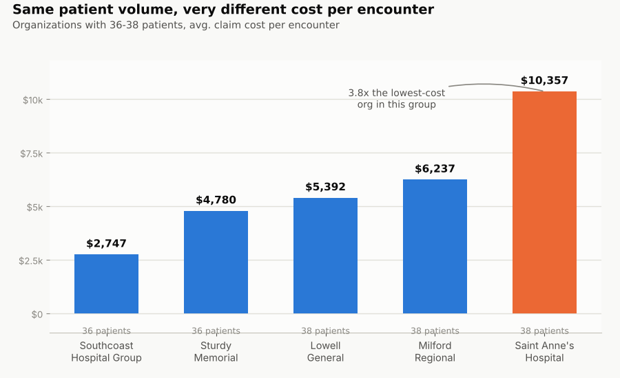

# Healthcare Data Analytics (Synthea)

This is a SQL analytics project built on [Synthea](https://github.com/synthetichealth/synthea) synthetic patient
data, modeled as a star schema and queried in MySQL. I built this to demonstrate practical
data-analyst SQL: schema design, ETL/data cleaning, window functions, knowledge and the ability to answer
real operational and clinical questions from patient-level data.


## Key Findings

**Population and risk signals.** The ten most common clinical diagnoses are respiratory
and minor acute conditions — viral sinusitis leads by a wide margin (739 patients, 1,233
diagnoses, reflecting repeat episodes rather than one-off cases), followed by pharyngitis,
bronchitis, and anemia. The parallel social-determinants-of-health cut surfaces a separate,
equally real signal: the top finding by raw count is "full-time employment" at 13,805
logged instances across only 834 patients — a ~16.5x ratio that tells you this field gets
re-recorded at nearly every encounter rather than noted once, unlike a stable clinical
diagnosis like anemia (324 diagnoses, 324 patients, exactly 1:1). Reading a diagnosis count
without that distinction would badly misstate what either number actually means.

**Cost doesn't track volume.** Among organizations with nearly identical patient volume
(36-38 patients), average cost per encounter ranges from $2,747 to $10,357 — roughly 3.8x.
That spread isn't a smooth gradient across five similar hospitals; it's one outlier (Saint
Anne's Hospital) running more than 1.6x above the next-highest facility in the same volume
band. Separately verified that the provider-level cut returns numbers numerically identical
to the organization-level one, row for row — this dataset effectively has one provider per
organization, so a "by provider" breakdown adds no independent signal here.



**The top spend patient is real, not a bug.** The highest-spend patient in the dataset
totals $18.85M — about 6.4x the next-highest patient ($2.93M). Checked directly against
the source rather than reported at face value: this patient has 412 distinct encounters
with no duplicate rows inflating the total, so the number reflects genuinely exceptional
care volume, not a join or load artifact.

**All-cause 30-day readmissions: 35.5%.** 613 of 1,728 inpatient encounters were followed
by another inpatient stay within 30 days. This runs well above typical published hospital
readmission rates, which is expected given how the measure is simplified here: it's
all-cause rather than diagnosis-matched, and includes no exclusion for planned
readmissions — both push a simplified proxy higher than CMS's own condition-specific
measure. A small number of 0-or-negative-gap rows come from overlapping inpatient
encounter records in the source data; flagged in the query rather than filtered out.

## Why this project

I have a background in EHR/healthcare systems, and wanted a portfolio piece that plays
to that rather than a generic retail/e-commerce dataset every other candidate uses.
Synthea generates fully synthetic patient populations (no real PHI, no compliance risk)
that are still structurally realistic — encounters, diagnoses, medications, procedures,
and vitals/labs, all tied together the way a real EHR export would be.

## Dataset

[Synthea](https://github.com/synthetichealth/synthea) — MITRE's open-source synthetic
patient generator. Data is 100% synthetic; no real patient information is used anywhere
in this project.

**Getting the data** (pick one):
- **Run the generator yourself** (recommended — lets you size and pick a state):
  1. Install Java, then clone `https://github.com/synthetichealth/synthea`.
  2. In `src/main/resources/synthea.properties`, set `exporter.csv.export = true`.
  3. Run `./run_synthea -p 1000 Massachusetts` (swap in the patient count / state you want).
  4. CSV files land in `./output/csv/`.
- **Pre-generated downloads**: MITRE also publishes ready-made sample populations at
  [synthea.mitre.org/downloads](https://synthea.mitre.org/downloads) if you'd rather skip
  running the generator.

This project uses 8 of Synthea's ~18 CSV exports for v1: `patients`, `encounters`,
`conditions`, `medications`, `procedures`, `observations`, `organizations`, `providers`.
(`immunizations`, `allergies`, `careplans`, `devices`, `imaging_studies`, `supplies`,
`payers`, `payer_transitions` are candidates for a v2 extension.)

## Architecture

Two layers, both in MySQL (built/run locally in MySQL Workbench):

```
Synthea CSVs  --(LOAD DATA)-->  Staging tables (stg_*)  --(SQL transform)-->  Star schema
```

**Staging layer** — one table per CSV, columns as close to the raw export as possible.
Nothing is cleaned or typed strictly here; that isolates "did the load work" from "is the
transform correct."

**Star schema:**

| Table | Type | Grain |
|---|---|---|
| `dim_date` | dimension | one row per calendar day |
| `dim_patient` | dimension, **Type 2 SCD** | one row per patient version |
| `dim_organization` | dimension, Type 1 | one row per facility |
| `dim_provider` | dimension, Type 1 | one row per provider |
| `fact_encounters` | fact | one row per encounter |
| `fact_conditions` | fact (factless) | one row per diagnosed condition |
| `fact_medications` | fact | one row per medication order |
| `fact_procedures` | fact | one row per procedure performed |
| `fact_observations` | fact | one row per recorded observation (vital/lab/survey) |

`dim_patient` is built as a real Type 2 SCD (`effective_start_date`, `effective_end_date`,
`is_current`) even though the first Synthea export is a single snapshot — the structure is
there so that a second export, re-loaded later, would actually accumulate patient history
instead of silently overwriting it.

See [`sql/`](./sql) for the full DDL and load scripts, run in order 01 → 05, plus the full
analysis queries in [`sql/06_analysis_queries.sql`](./sql/06_analysis_queries.sql).

## Analysis questions

All nine are answered in [`sql/06_analysis_queries.sql`](./sql/06_analysis_queries.sql),
each with its business framing, the stakeholder it stands in for, and — where relevant —
an alternative that was considered and rejected, with the reasoning for why. Headline
results are summarized in Key Findings above; this section documents the full reasoning
behind each query.

1. What are the top 10 most common diagnosed conditions, and how does prevalence differ
   by age band and gender?
   - **Business question:** which conditions carry the heaviest disease burden in this
     population, and which age/gender segments carry it — used to prioritize service
     lines, staffing, and screening programs.
   - **Stakeholder:** clinical operations / population health leadership. (The parallel
     SDOH-findings cut serves a related but distinct audience — case management/social
     work teams screening for social risk factors, separate from clinical diagnosis.)

2. What's the month-over-month trend in total encounter volume and total claim cost?
   - **Business question:** is utilization and cost rising, falling, or stable over time,
     and are there anomalous months worth investigating — used for capacity forecasting
     and tracking whether cost-control efforts are working.
   - **Stakeholder:** finance / operations leadership, revenue cycle management.

3. Which patients have the highest total healthcare spend, and what's driving it
   (encounters vs. medications vs. procedures)?
   - **Business question:** classic high-cost-patient identification — a small group of
     patients typically drives a disproportionate share of total spend, and knowing what's
     actually driving each patient's cost (encounters vs. meds vs. procedures) determines
     whether the intervention is care coordination, utilization review, or something else.
   - **Stakeholder:** care management / population health.
   - **Considered and rejected:** a second cut ranking patients by `patient_responsibility`
     (billed minus payer-covered) to serve a finance "who's our biggest uncollected-exposure
     risk" question. Rejected because that number only reflects what a patient was billed
     as owing at claim time, not whether it was ever paid — Synthea has no payments/
     collections ledger, so there's no way to tell a fully-paid balance from a two-year
     delinquent one. Without that, a financial-exposure ranking can't actually be answered
     from this dataset, so total billed spend stays the sole ranking here.

4. What's the average length of stay by encounter class (inpatient/outpatient/emergency),
   and are there outliers worth flagging?
   - **Business question:** what's a normal length of stay per encounter type, for bed
     capacity and discharge-planning benchmarks — and separately, which extreme values are
     real (worth a utilization-review look) versus data-quality artifacts (bad timestamps)
     that would corrupt any benchmark built on top of them.
   - **Stakeholder:** hospital operations / capacity planning; data governance for the
     outlier/data-quality half.

5. Which organizations have the highest patient volume, and how does that correlate with
   average cost per encounter?
   - **Business question:** how does cost per encounter vary across facilities independent
     of scale — used to spot efficiency outliers, inform payer contract negotiations, or
     identify best-practice sites. Confirmed genuinely useful: organizations with nearly
     identical patient volume (36-38 patients) still showed close to a 4x spread in average
     cost per encounter, meaning cost isn't just a function of size.
   - **Stakeholder:** network operations / contracting, executive leadership.
   - **Considered and rejected:** a matching provider-level cut (originally Q5b). Rejected
     because it's not actually answerable from this dataset — verified that essentially all
     of an organization's encounter volume routes through a single provider record even
     though many more are rostered, so a "by provider" query returns numbers numerically
     identical to the organization-level one rather than real provider-level variation.
     Presenting that as a distinct provider-efficiency answer would overstate what the data
     supports.

6. Using window functions: for each patient, what's their most recent encounter and how
   many days since their previous one? Split into two distinct questions rather than one,
   since they serve different stakeholders (see the full discussion this took to get here
   in the project notes):
   - **6a — Days since last seen:** how long has it been since each patient's most recent
     encounter, relative to today.
     - **Business question:** who's falling out of care and needs outreach right now.
     - **Stakeholder:** care management / population health (an actionable outreach list).
   - **6b — Inpatient readmission gap (CMS-style, simplified):** for inpatient encounters
     specifically, how many days elapsed between a discharge and the patient's next
     inpatient admission — flagging gaps of 30 days or less. Modeled as a simplified,
     all-cause proxy for CMS's Hospital Readmissions Reduction Program measure (every
     discharge is its own index event checked independently; readmission diagnosis doesn't
     need to match the original) — not a full replication of CMS's official condition-
     specific eligibility and planned-readmission exclusion logic.
     - **Business question:** is care actually holding after discharge, or are patients
       bouncing back too soon — a real, penalized quality/financial metric for hospitals.
     - **Stakeholder:** hospital quality leadership, finance (CMS payment exposure).

7. Pivot: condition counts by year, one column per year, to see which diagnoses are
   trending up or down over time.
   - **Business question:** which diagnoses are becoming more or less common over time
     in this population — used to spot emerging health trends early enough to shift
     staffing, service lines, or screening programs toward them.
   - **Stakeholder:** population health / clinical program planning.
   - Scoped to the same top-10 real clinical diagnoses ("(disorder)" only, SDOH findings
     excluded) used in Q1, and to whole calendar years 2012–2026 — the same last-15-years
     reasoning as Q2. Built with manual CASE-based pivoting (one column per year), since
     MySQL has no native PIVOT operator — a known tradeoff of that approach is that the
     year columns are hardcoded and need updating by hand as more years of data accumulate.

8. Anti-join: which patients 45 and older have never had a diabetes diagnosis or
   diabetes-related condition documented, despite being in the age range where
   screening guidance (USPSTF/ADA) generally applies?
   - **Business question:** a gap-in-care/outreach list — the same shape as a
     HEDIS-style screening-compliance report.
   - **Stakeholder:** preventive care / population health, quality improvement.
   - Matches broadly on "diabetes" in the condition description (catches complications
     and prediabetes too, not just a strict type-2 diagnosis code) so a patient who's
     been evaluated for anything diabetes-adjacent isn't miscounted as a screening gap.
     Excludes deceased patients — an outreach list only makes sense for patients still
     eligible to be screened.

9. As-of query against `dim_patient`: what did a patient's on-file demographic info look
   like at a specific point in time (exercises the Type 2 SCD design even on v1 data).
   - **Business question:** reconstruct what our records said about a patient as of a
     specific past date — e.g. verifying what was on file at the time of a claim,
     encounter, or care decision, not what's true about them today.
   - **Stakeholder:** data governance / compliance; care coordination doing a
     retrospective case review.
   - **Caveat:** the first Synthea load gives every patient exactly one `dim_patient`
     version, so this query would return the same row for any date on that data alone —
     proving the SCD plumbing works but not a real before/after.
     [`sql/07_simulate_scd_change.sql`](./sql/07_simulate_scd_change.sql) manufactures
     real history for 5 patients (a `marital_status` change effective 2023-06-01, the
     simplest single-column change to simulate cleanly) specifically so this question
     has something real to show.

## Setup

1. Get Synthea CSV output (see "Getting the data" above).
2. In MySQL Workbench, run `sql/01_staging_schema.sql`.
3. Edit the file paths in `sql/02_load_staging.sql` to point at your CSVs, then run it.
4. Run `sql/03_star_schema.sql`.
5. Run `sql/04_load_dimensions.sql`, then `sql/05_load_facts.sql`.
6. Each script ends with a row-count sanity check — confirm counts look reasonable
   before moving to analysis queries.
7. (Optional, only needed for Q9) Run `sql/07_simulate_scd_change.sql` once to
   manufacture real Type 2 SCD history for a handful of patients — see Q9 above for why.
8. Run the analysis queries in `sql/06_analysis_queries.sql`.

## Tech

MySQL 8 (MySQL Workbench), SQL only for v1. Excel/BI-tool visualizations may be added
as the study plan reaches that phase.
